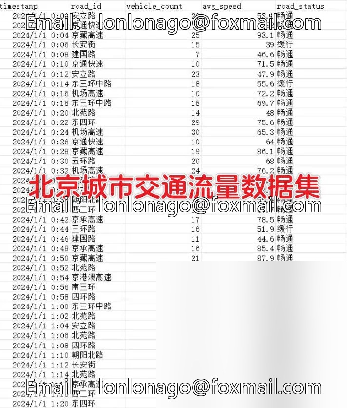
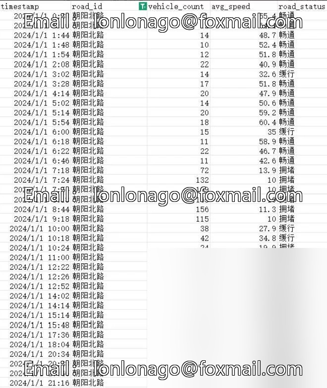
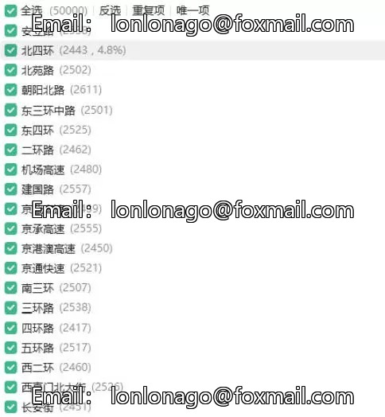

# Beijing urban traffic flow dataset of 50,000 entries

## Body

Beijing urban traffic flow dataset of 50,000 records
Time distribution: January 1, 2024 - March 10, 2024
Column description:
timestamp time stamp
road_id road name
vehicle_count vehicle count
avg_speed average speed
road_status road status

web-based shipment, can be directly photographed and shipped.

The dataset contains Beijing urban traffic flow data totaling 50,000 records, including a time distribution, column descriptions and specific example entries.

<!-- AI_ENRICHED -->

## Images

## Payment

Here is a pay link on Stripe ( https://buy.stripe.com/3cs8yP7sY87d0vu9AB ). Please contact me lonlonago@foxmail.com after funding $89, and I will send you a complete data files , thank you!

